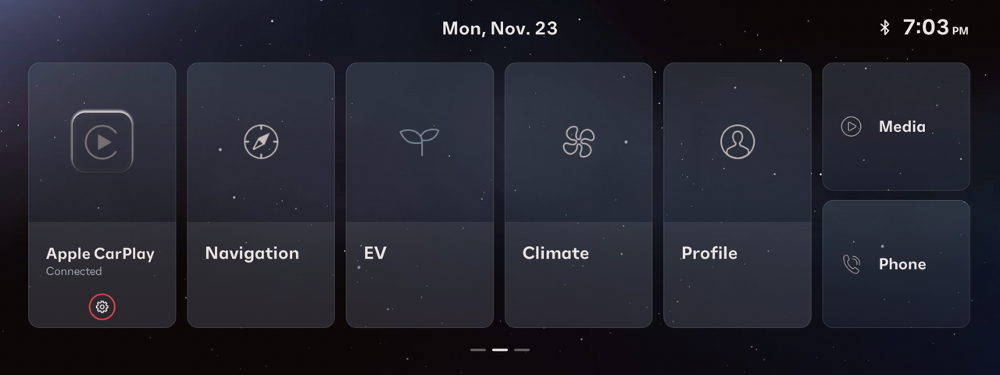
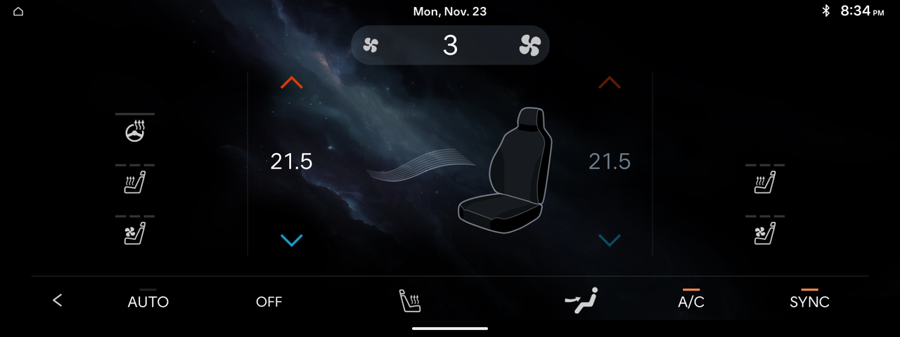
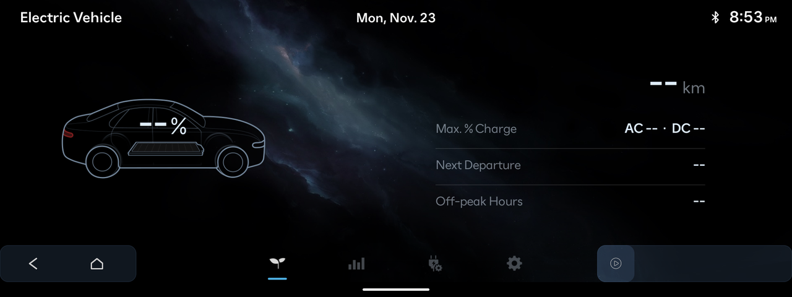
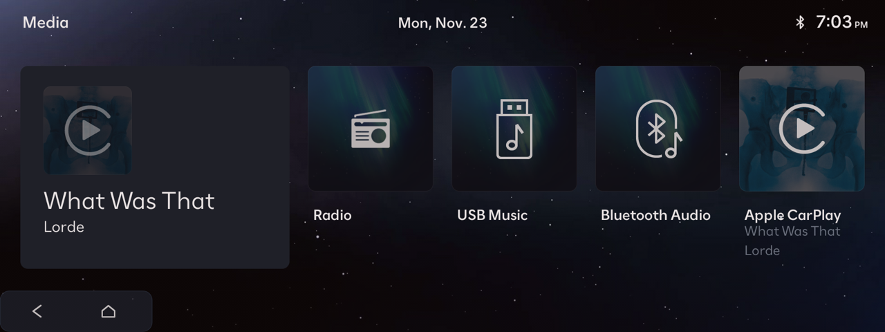
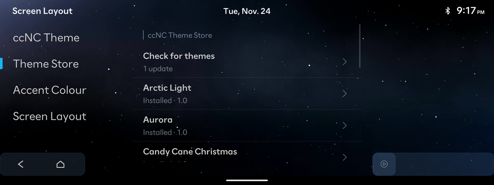

# ccNC for Gen5W

**Hyundai and Kia's newest ccNC infotainment look, on Gen5W head units.**

[Install](docs/INSTALL.md) · [Features](docs/FEATURES.md) · [Safety](docs/SAFETY.md) · [Themes](https://github.com/JacobPantuso/ccnc-themes) · [Developer menu](docs/DEVELOPER-MENU.md) · [Building](BUILDING.md)

---

## Overview

ccNC for Gen5W replaces the Gen5W home screen and everyday apps with ccNC-style versions. It installs as
**one NEMESIS package**: a new launcher, Climate, EV, Media, Settings and seven more apps, plus a few small
system changes made with NEMESIS LivePatch so the car's own buttons and pop-ups fit the new look.

- **Nothing in `/system` is rewritten.** LivePatch mounts patched copies at startup; uninstalling brings the
  stock files back.
- **The stock apps stay installed.** Everything the car does, it still does.
- **One-tap removal.** Uninstall from NEMESIS Manager and restart.

> Built and tested on a 2023+ Hyundai Ioniq 6 (firmware `CEEV.CAN.S5W_M.V014.010.250818`). Hyundai and Kia
> are both supported. This project is not affiliated with Hyundai or Kia.

## At a glance

<table>
<tr>
<td width="50%"> <b>Home</b>: clock, weather and what's playing.</td>
<td width="50%"> <b>Climate</b>: the car's climate and seat buttons open it.</td>
</tr>
<tr>
<td> <b>EV</b>: battery, range, charge limits and schedules.</td>
<td> <b>Media</b>: CarPlay, Bluetooth, USB and radio in one place.</td>
</tr>
<tr>
<td> <b>Settings</b>: the car's own settings, in ccNC style.</td>
<td> <b>Themes</b>: 11 built in, more from the Theme Store.</td>
</tr>
</table>

See every app in **[Features](docs/FEATURES.md)**.

## Quick install

1. Make sure your head unit has **NEMESIS with LivePatch** (1.17.1 or newer).
2. In **NEMESIS Manager > Package Store**, install **ccNC for Gen5W**, or install it from a USB stick with
   the zip from the [latest release](https://github.com/JacobPantuso/ccnc-gen5w/releases/latest).
3. Restart the head unit, press **Home** and choose **ccNC Home > Always**.

Full steps, updating from 1.x and uninstalling: **[Install guide](docs/INSTALL.md)**.

## Is it safe?

ccNC is a hobby project, built carefully and tested on a real car, but it modifies your head unit. Read
**[Safety](docs/SAFETY.md)** before installing. In short:

| | |
|---|---|
| Apps | Added alongside the stock apps; removed on uninstall. |
| System changes | Made by LivePatch, never written to `/system`; stock again after uninstall and a restart. |
| Unsupported firmware | Each change checks it fits your firmware and leaves the file stock if it doesn't. |
| If the unit doesn't start | NEMESIS starts stock automatically after failed boots (safe mode). |

Install while parked. Don't use the screen while driving. Use at your own risk.

## Documentation

| Guide | What's in it |
|---|---|
| [Install](docs/INSTALL.md) | Requirements, installing, first setup, updating from 1.x, uninstalling |
| [Features](docs/FEATURES.md) | Every app and system change, with screenshots |
| [Safety](docs/SAFETY.md) | What ccNC changes, how it's kept reversible, recovery |
| [Troubleshooting](docs/TROUBLESHOOTING.md) | Common problems and fixes |
| [Developer menu](docs/DEVELOPER-MENU.md) | Status, CPU, compatibility and on-car checks |
| [Building](BUILDING.md) | Building the apps and the package from source |
| [ccnc-themes](https://github.com/JacobPantuso/ccnc-themes) | The theme catalog and how to make your own |

## License

Code: [MIT](LICENSE). ccNC, Hyundai, Kia and their artwork, fonts and logos belong to their owners; they are
not in this repository (the release packages include what the apps need).
