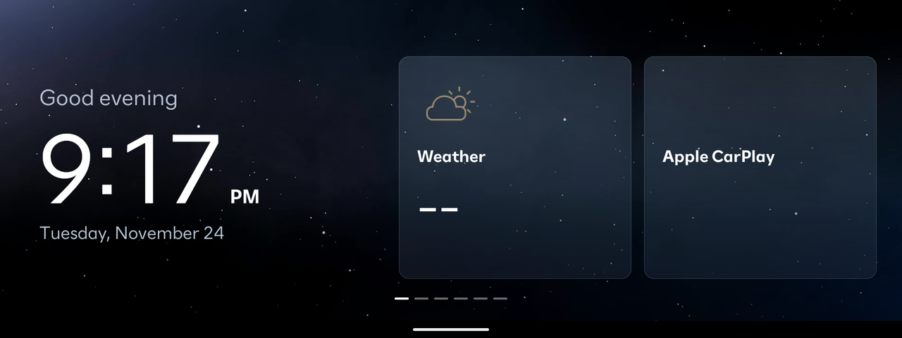
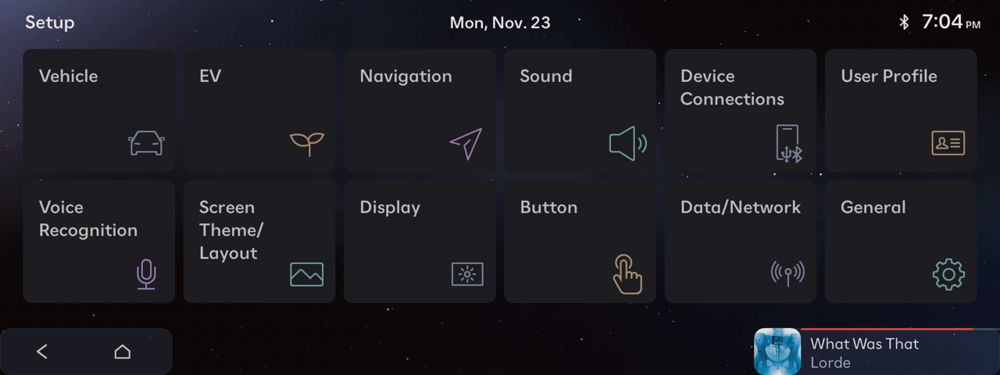
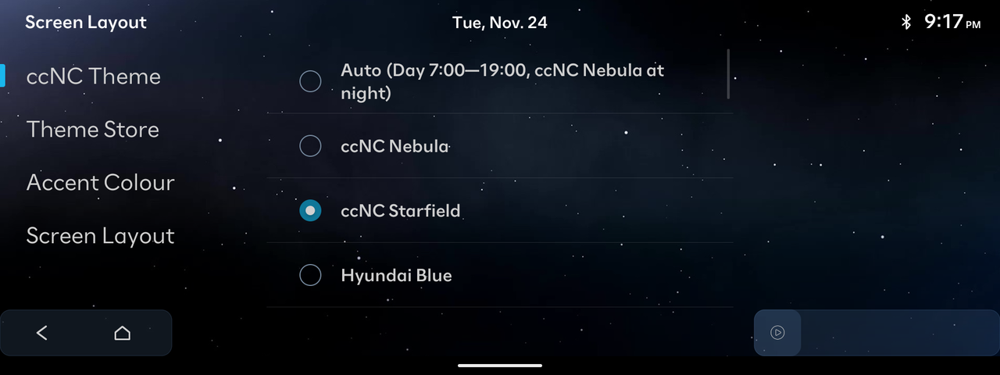
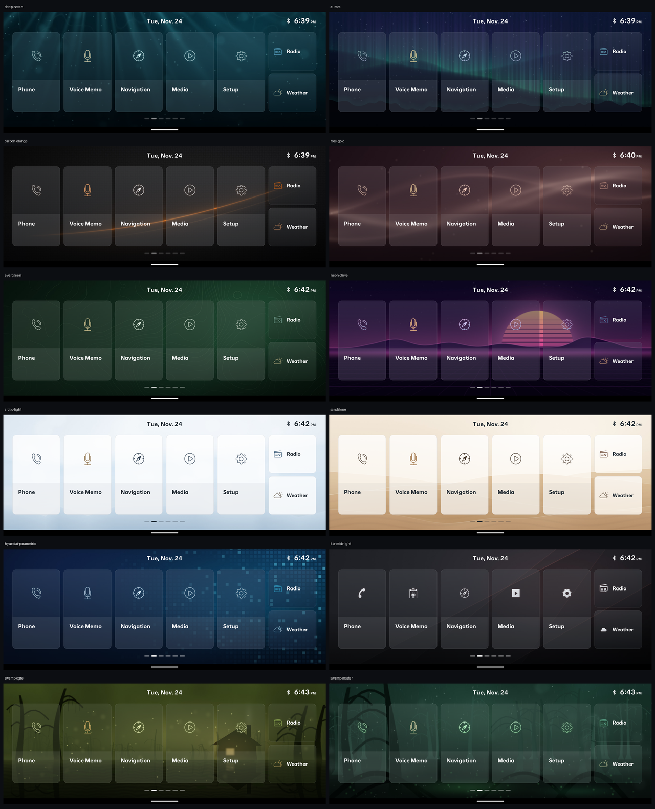

# ccNC for Gen5W

**The look of Hyundai and Kia's newest ccNC infotainment, on Gen5W head units.**

ccNC replaces the Gen5W home screen and everyday apps with ccNC-style versions: a new launcher, Climate, EV,
Media, Settings and more, plus themes you can install over Wi-Fi. Your car keeps working exactly as before: the
stock apps stay installed, and everything can be uninstalled.

> Built and tested on a 2023+ Hyundai Ioniq 6 (head-unit firmware `CEEV.CAN.S5W_M.V014.010.250818`).
> Kia and Hyundai are both supported in the apps. Not affiliated with Hyundai or Kia.

---

## What you get

| | |
|---|---|
| **ccNC Home** | Welcome page with a big clock, weather and now playing; card pages for your apps; stackable cards; a ccNC bottom bar with back, home and now playing. |
| **Climate** | Temperatures, fan, air flow, A/C, sync, heated/ventilated seats, rear seats and the heated steering wheel, in the ccNC layout. Optional: the car's climate and seat buttons open it. |
| **EV** | Battery and range, charge limits, departure and off-peak schedules, energy use. |
| **Settings** | The car's own Settings categories redrawn in ccNC style, including vehicle and EV menus, display, sound, themes and ambient-light colours. |
| **Media, Radio, Phone, Weather, Navigation, Voice Memo, Profile** | ccNC-style versions of the everyday screens. |
| **Themes** | 13 built-in looks plus a Theme Store with community themes, installed over Wi-Fi. |

## Screenshots

### Home

*The welcome page: clock, greeting, weather and what's playing.*

*Your apps as ccNC cards. Long-press to rearrange, hide or stack them.*

### Climate

*Front temperatures, fan and air flow, with seat and steering-wheel heat at the sides.*

*The seat popup: driver and passenger heat and ventilation, rear seats and the steering wheel. Opens with the car's seat button too.*

### EV

*Battery, range, charge limits and your next departure.*

*Charge limits and the scheduled charging / climate plan. (Emulator screenshot: values show `--` without a car.)*

### Media

*Every source in one place: CarPlay, Bluetooth, USB and radio.*

### Settings

*Your car's own Settings categories, in ccNC style.*

### Themes

*Pick a theme in Settings > Screen Theme > ccNC Theme. Every ccNC app follows it.*

*The Theme Store: themes published in [ccnc-themes](https://github.com/JacobPantuso/ccnc-themes), installed over Wi-Fi.*

---

## Install

You need **NEMESIS** on your head unit first (it's what installs ccNC). Then pick one:

### Option A: NEMESIS Package Store (easiest)

1. Open **NEMESIS Manager > Package Store** and search for **ccNC**.
2. Install **ccNC Apps**, then **ccNC Home**.
3. Press the **Home** button and choose **ccNC Home**, then **Always**.

### Option B: USB stick

1. Download **`ccnc-all-nemesis.zip`** from the [latest release](https://github.com/JacobPantuso/ccnc-gen5w/releases/latest).
2. Unzip it onto the **root** of a USB stick (you should see `NEMESIS.data` and a `packages` folder).
3. Plug the stick into the car, open **NEMESIS Manager > Package Store** and install **ccNC Apps**, then **ccNC Home**.
4. Press **Home** and choose **ccNC Home**, then **Always**.

### Packages

| Package | What it does | Changes system files? |
|---|---|---|
| **ccNC Apps** | Settings, Climate, EV, Media, Radio, Phone, Weather, Navigation, Voice Memo, Profile | No |
| **ccNC Home** | The launcher | No |
| ccNC Climate Buttons *(optional)* | The car's climate and seat buttons open ccNC Climate | Yes, one file (restart after) |
| ccNC Side Popups Off *(optional)* | Hides the Gen5W pop-ups on the right-hand screen | Yes, one file (restart after) |
| ccNC Volume *(optional)* | Hides the Gen5W volume strip; ccNC shows its own | Yes, one file (restart after) |
| ccNC Startup Video *(optional)* | ccNC's welcome video when the car starts | Yes, one file (restart after) |

Install while **parked**.

---

## Please read: the small print

ccNC is a hobby project. It's built carefully and most of it is low risk, but you are modifying your car's
head unit, so know what you're doing:

- **The apps are low risk.** ccNC Apps and ccNC Home only add apps. Nothing in the system is changed, the stock
  apps stay where they are, and uninstalling them in NEMESIS Manager puts everything back.
- **The optional extras change one system file each.** Each one checks the file is exactly the one it was made
  for and refuses to install otherwise, backs the original up first, and puts it back when you uninstall. They
  are made for firmware `CEEV.CAN 250818` only. If the head unit ever doesn't come back after installing one,
  the release has a matching **restore** package for NEMESIS's emergency mode.
- **Car controls are the car's own.** Climate, EV and vehicle settings talk to the car through the same services
  the stock apps use. Climate starts in view-only mode; you have to switch on "Vehicle control" yourself.
- **Not tested on every car.** Other Gen5W cars and firmware may work for the apps, but haven't been tested.
- **Don't use it while driving**, keep your eyes on the road, and remember that modifying your head unit may
  affect your warranty. Use at your own risk.

---

## Themes

ccNC comes with 13 themes (Nebula, Starfield, Deep Ocean, Aurora, Candy Cane Christmas and more) and can
install more over Wi-Fi from the **Theme Store** (Settings > Screen Theme > Theme Store). A theme changes the
wallpaper, colours and icons of every ccNC app, and can include a startup video.

**Browse, download or make your own themes:** [**github.com/JacobPantuso/ccnc-themes**](https://github.com/JacobPantuso/ccnc-themes)

---

## Developer menu

Tap the clock in any ccNC top bar **7 times** for the developer menu: status of every ccNC app and system
patch, live CPU usage, a compatibility check for your car, an on-car check that saves a report to your USB
stick, and reboot.

## Uninstall

Uninstall any package from **NEMESIS Manager**. The system extras restore the original file (restart the head
unit afterwards). If ccNC Home was your home screen, the stock home comes back automatically.

## Building from source

See [BUILDING.md](BUILDING.md). The ccNC fonts and artwork aren't in this repository (they belong to Hyundai /
Kia); the ready-made packages in the releases include them.

## License

Code: [MIT](LICENSE). ccNC, Hyundai, Kia and their artwork, fonts and logos belong to their owners.
