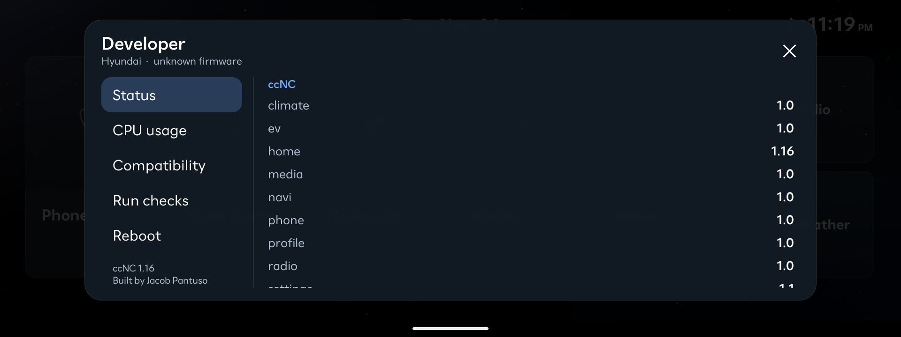
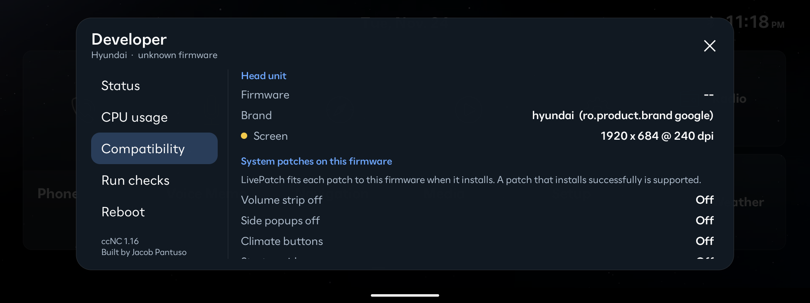

# Developer menu

[← Back to README](../README.md)

Tap the clock in any ccNC top bar **7 times** within 3 seconds.

| Page | What it shows |
|---|---|
| **Status** | Every ccNC app and its version, the theme, brand, each system change, NEMESIS and HMG-API, uptime, memory and storage |
| **CPU usage** | Total CPU, load and memory, and the busiest processes, refreshed every 2 seconds |
| **Compatibility** | Firmware, brand detection, screen, which system changes fit this firmware, car services and the stock apps ccNC uses |
| **Run checks** | Opens each ccNC app briefly and saves a report and screenshots to `ccNC reports/` on a USB stick |
| **Reboot** | Restarts the head unit, after a confirmation |

## System change states

| State | Meaning |
|---|---|
| **Active** | LivePatch has the patched copy in place |
| **Installed, restart to apply** | Installed; applies at the next restart (or NEMESIS is in safe mode) |
| **Not supported on this firmware** | The change didn't fit this firmware and was skipped; the file is stock |
| **Off** | Not installed |

With LivePatch, a change that installs successfully is supported on your firmware.

<table>
<tr>
<td width="50%"> Compatibility (emulator)</td>
<td width="50%"> Reboot asks first</td>
</tr>
</table>
