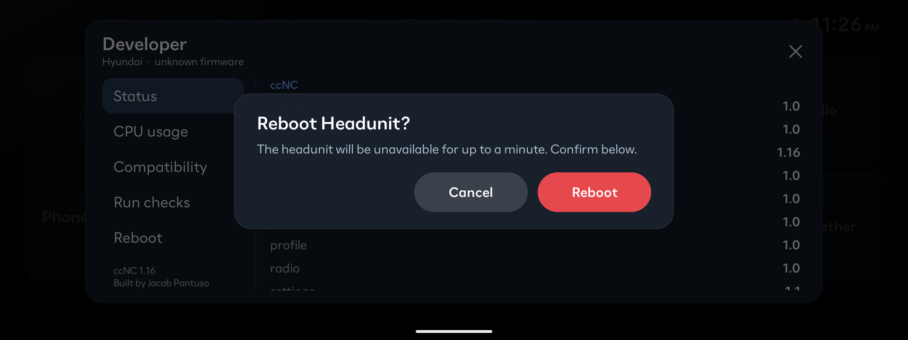

# Developer menu

[← Back to README](../README.md)

Tap the clock in any ccNC top bar **7 times** within 3 seconds. A tap outside closes it once it has been open for 3 seconds.

| Page | What it shows |
|---|---|
| **Status** | Every ccNC app and its version, the theme, brand, each system change, NEMESIS and HMG-API, uptime, memory and storage. **Open Stock Home** opens the Gen5W's own home screen |
| **CPU Usage** | Total CPU, load and memory, and the busiest processes, refreshed every 2 seconds |
| **Compatibility** | Firmware, brand detection, screen, which system changes fit this firmware, car services and the stock apps ccNC uses |
| **Export Logs** | Saves a summary of the car and ccNC plus the head unit's recent logs to `ccNC logs/<date-time>/` on a USB stick, for bug reports. Personal information is removed first: paired phones' names and addresses, profile names, Wi-Fi network, phone numbers, email addresses, locations, VIN, device IDs and phone book, message and call lines (`SANITIZED.txt` lists what was removed). Needs a stick (greyed out without one) and NEMESIS root. Look the files over before sharing them |
| **Reboot** | Restarts the head unit, after a confirmation |

## System change states

| State | Meaning |
|---|---|
| **Active** | LivePatch has the patched copy in place |
| **Installed, restart to apply** | Installed; applies at the next restart (or NEMESIS is in safe mode) |
| **Not supported on this firmware** | The change didn't fit this firmware and was skipped; the file is stock |
| **Patch tool error** | The patch tool failed; see NEMESIS's log (the install stopped, so nothing was changed) |
| **Patched by LivePatch (no ccNC record)** | Something is mounted over the file but ccNC has no record of it |
| **Off** | Not installed |

With LivePatch, a change that installs successfully is supported on your firmware.

<table>
<tr>
<td width="50%"> Compatibility (emulator)</td>
<td width="50%"> Reboot asks first</td>
</tr>
</table>
