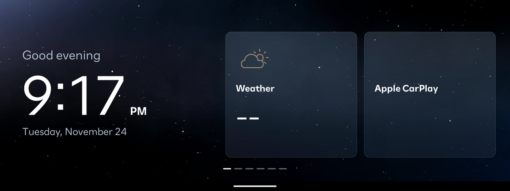
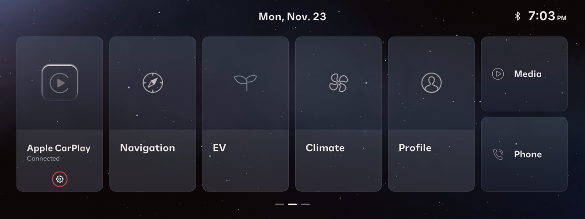
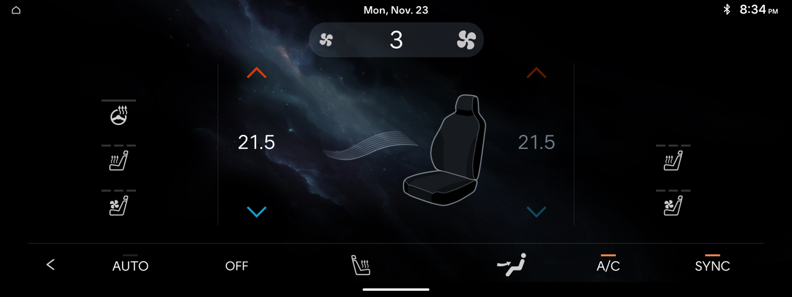
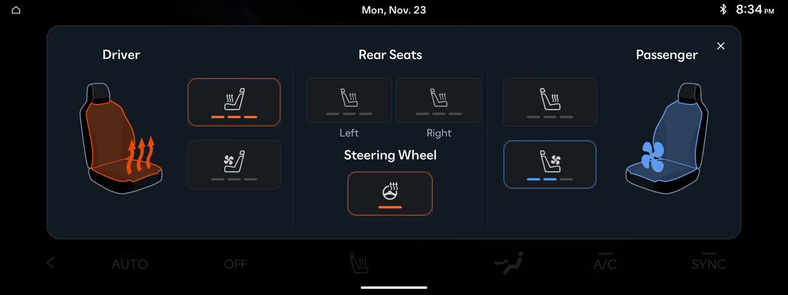
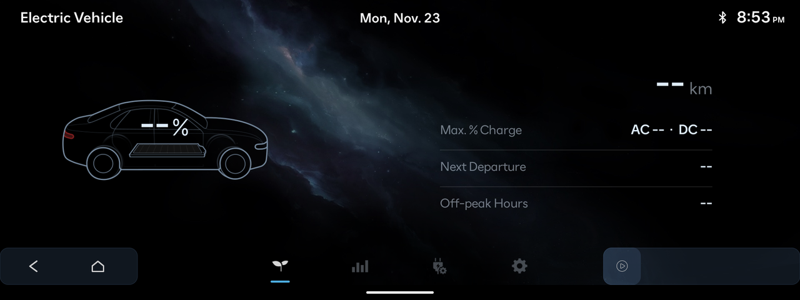
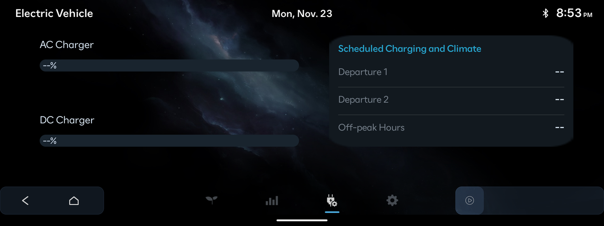
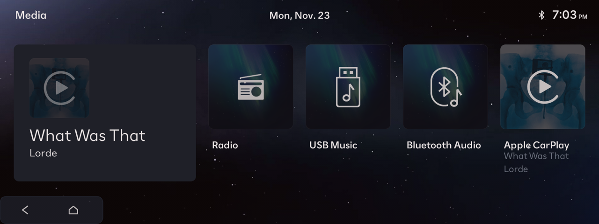
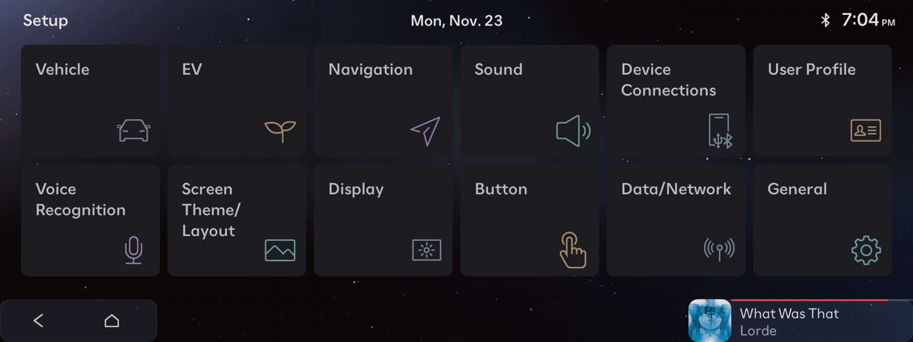
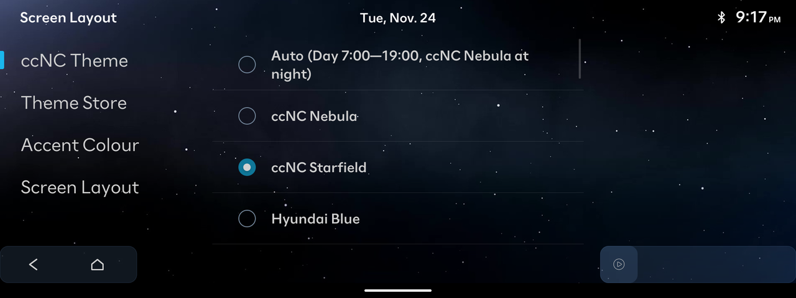
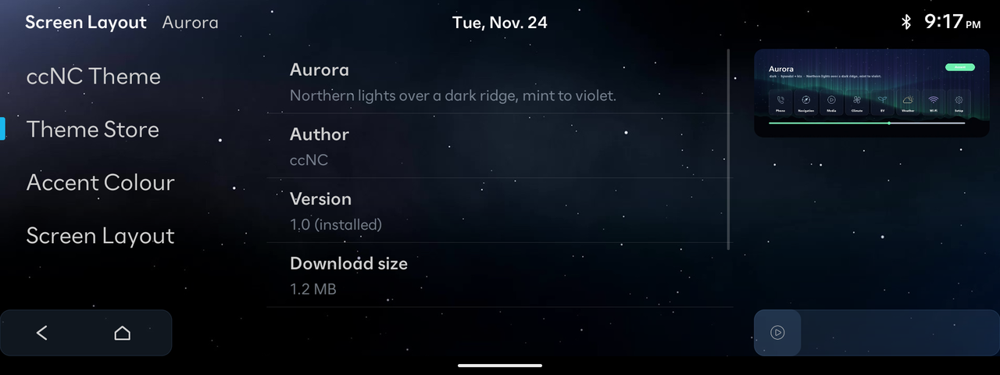

# Features

[← Back to README](../README.md)

## Contents

- [Home](#home) · [Climate](#climate) · [EV](#ev) · [Media](#media) · [Settings](#settings) · [Themes](#themes)
- [More apps](#more-apps)
- [System changes](#system-changes)
- [Hyundai and Kia](#hyundai-and-kia)

---

## Home

The welcome page shows a large clock, a greeting, the weather and what's playing.

Swipe for your apps as ccNC cards. Long-press to rearrange, hide or stack cards. The bottom bar has back, home
and a now-playing strip on every ccNC screen.

## Climate

Driver and passenger temperatures, fan speed, air flow, A/C, sync, heated and ventilated seats, rear seats and
the heated steering wheel.

The seat popup opens from the car's seat button. Every control on the screen changes the car's climate
directly, just like the stock climate screen.

## EV

<table>
<tr>
<td width="50%"></td>
<td width="50%"></td>
</tr>
</table>

Battery, range, AC and DC charge limits, departure and off-peak schedules and energy use. The car's own EV
settings are available in ccNC Settings.

## Media

CarPlay, Bluetooth, USB and radio sources in one place, with the now-playing card on Home.

## Settings

The car's own Settings categories, redrawn: vehicle, EV, display, sound, ambient-light colours (with colour
swatches) and themes.

## Themes

<table>
<tr>
<td width="50%"> Settings > Screen Theme > ccNC Theme</td>
<td width="50%"> The Theme Store</td>
</tr>
</table>

A theme changes the wallpaper, colours and icons of every ccNC app. Eleven are built in; the Theme Store
installs more over Wi-Fi from [ccnc-themes](https://github.com/JacobPantuso/ccnc-themes). Nothing installs
by itself: when the car joins Wi-Fi, ccNC only tells you about new themes and updates.

## More apps

ccNC-style versions of **Radio**, **Phone**, **Weather**, **Navigation**, **Voice Memo** and **Profile**, in the
same layout, fonts and theme as the rest.

## System changes

Made with NEMESIS LivePatch: nothing is written to `/system`, and each one is undone by uninstalling.

| Change | What you notice |
|---|---|
| Climate buttons | The car's climate and seat buttons open ccNC Climate instead of the stock screens |
| Volume strip off | The Gen5W volume bar is hidden; ccNC shows its own |
| Side pop-ups off | The Gen5W pop-ups on the right-hand screen are hidden |
| Startup video | ccNC's welcome video (Hyundai or Kia) when the car starts |

If a change doesn't fit your firmware, it's skipped and that file stays stock; the apps still install. The
[developer menu](DEVELOPER-MENU.md) shows which changes are active.

## Hyundai and Kia

ccNC detects the brand from the firmware and uses the matching fonts, names (for example *Kia Connect*),
startup video and brand themes.
